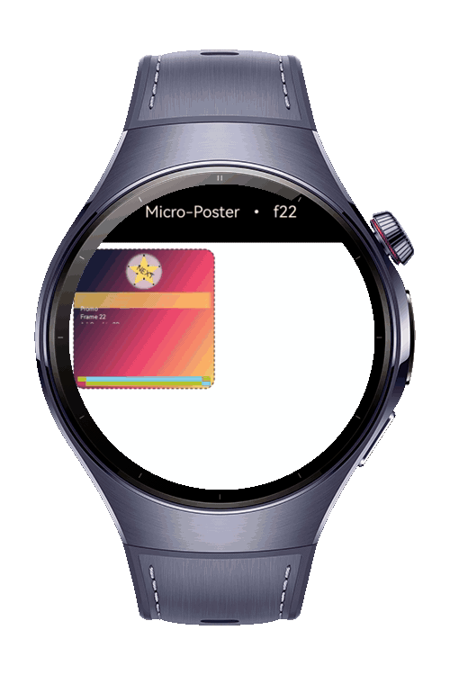

> **Note:** To access all shared projects, get information about environment setup, and view other guides, please visit [Explore-In-HMOS Index](https://github.com/Explore-In-HMOS/hmos-index).

# How to Build a Micro Poster Renderer
This project demonstrates how to build a micro poster renderer on HarmonyOS Next wearable devices using every ArkGraphics2D drawing module via a RenderNode-based pipeline driven by displaySync animation.

# Preview
<div>
  
</div>

# Use Cases

- **PosterRenderer**: A custom RenderNode that drives drawing.Canvas directly to render a micro poster with multiple ArkGraphics2D modules.
  - **RoundRect**: Draws the rounded poster frame with configurable corner radii.
  - **ShaderEffect**: Applies a linear gradient fill across the poster body.
  - **ShadowLayer**: Casts a soft shadow beneath the rounded poster frame.
  - **MaskFilter**: Adds a blur mask effect to the header badge circle.
  - **ImageFilter**: Applies a blur image filter to the promo strip.
  - **Path**: Builds and draws a custom star shape in the header.
  - **PathIterator**: Walks the star path to position decorative tick circles.
  - **PathEffect**: Animates a dashed border with composed dash and corner effects.
  - **Matrix**: Rotates headline text around the header center.
  - **RectUtils**: Builds, insets, and intersects all layout rectangles.
  - **Region**: Clips subsequent drawing bounds to the body region.
  - **Lattice**: Draws a nine-patch image lattice at the poster footer.
- **Index**: Entry page hosting the renderer through a NodeContainer with displaySync ~30 fps animation and uiEffect blur filter.

Modules and Methods

@kit.ArkGraphics2D

| Module | Method | Description |
|--------|--------|-------------|
| drawing.Canvas | drawColor() | Clears the canvas with a solid color |
| drawing.Canvas | drawRoundRect() | Draws the rounded poster frame |
| drawing.Canvas | drawCircle() | Draws the header badge and decorative ticks |
| drawing.Canvas | drawRect() | Draws the promo strip rectangle |
| drawing.Canvas | drawPath() | Draws the custom star shape |
| drawing.Canvas | drawTextBlob() | Draws rotated headline and body labels |
| drawing.Canvas | drawImageLattice() | Draws the nine-patch lattice footer |
| drawing.Canvas | clipRegion() | Clips drawing bounds to a region |
| drawing.Canvas | concatMatrix() | Applies a rotation matrix to the canvas |
| drawing.Canvas | attachBrush() / detachBrush() | Binds/unbinds a brush for fill operations |
| drawing.Canvas | attachPen() / detachPen() | Binds/unbinds a pen for stroke operations |
| drawing.Canvas | save() / restore() | Saves and restores canvas state |
| drawing.RoundRect | constructor() | Creates a rounded rectangle with corner radii |
| drawing.RoundRect | setCorner() | Configures individual corner radius |
| drawing.RoundRect | offset() | Offsets the rounded rectangle position |
| drawing.RectUtils | makeLtrb() | Creates a rect from left, top, right, bottom |
| drawing.RectUtils | makeCopy() | Copies an existing rect |
| drawing.RectUtils | inset() | Shrinks a rect by given margins |
| drawing.RectUtils | intersect() | Intersects two rects |
| drawing.RectUtils | getWidth() / getHeight() | Returns rect dimensions |
| drawing.RectUtils | centerX() / centerY() | Returns rect center coordinates |
| drawing.ShaderEffect | createLinearGradient() | Creates a linear gradient shader for body fill |
| drawing.ShadowLayer | create() | Creates a shadow layer beneath the poster frame |
| drawing.MaskFilter | createBlurMaskFilter() | Creates a blur mask filter for the badge |
| drawing.ImageFilter | createBlurImageFilter() | Creates a blur image filter for the promo strip |
| drawing.PathEffect | createDashPathEffect() | Creates an animated dash effect for the border |
| drawing.PathEffect | createCornerPathEffect() | Creates a corner rounding effect |
| drawing.PathEffect | createComposePathEffect() | Composes dash and corner effects together |
| drawing.Path | moveTo() / lineTo() / close() | Builds the custom star path geometry |
| drawing.PathIterator | constructor() | Creates an iterator to walk a path |
| drawing.PathIterator | hasNext() / next() | Iterates path segments for tick positions |
| drawing.Region | constructor() | Creates a clipping region |
| drawing.Region | setRect() | Defines the region bounds |
| drawing.Region | op() | Combines regions with UNION operation |
| drawing.Matrix | constructor() | Creates a transformation matrix |
| drawing.Matrix | setRotation() | Sets rotation around a pivot point |
| drawing.Lattice | createImageLattice() | Creates a nine-patch lattice definition |
| drawing.Brush | setColor() / setAntiAlias() | Configures brush color and anti-aliasing |
| drawing.Brush | setShaderEffect() | Applies a shader effect to the brush |
| drawing.Brush | setShadowLayer() | Applies a shadow layer to the brush |
| drawing.Brush | setMaskFilter() | Applies a mask filter to the brush |
| drawing.Brush | setImageFilter() | Applies an image filter to the brush |
| drawing.Pen | setStrokeWidth() / setColor() | Configures pen stroke width and color |
| drawing.Pen | setPathEffect() | Applies a path effect to the pen |
| drawing.Font | setSize() | Sets font size for text rendering |
| drawing.TextBlob | makeFromString() | Creates a text blob from a string |
| displaySync | create() | Creates a display sync instance |
| displaySync.DisplaySync | setExpectedFrameRateRange() | Sets target frame rate to ~30 fps |
| displaySync.DisplaySync | on('frame') | Registers frame callback for animation |
| displaySync.DisplaySync | start() / stop() | Starts and stops the animation loop |
| uiEffect | createFilter() | Creates a UI effect filter |
| uiEffect.Filter | blur() | Applies a blur filter to the host Stack |

@kit.ArkUI

| Module | Method | Description |
|--------|--------|-------------|
| RenderNode | draw() | Override to push drawing commands onto canvas |
| RenderNode | invalidate() | Triggers a repaint of the render node |
| NodeController | makeNode() | Creates and returns the FrameNode tree |
| FrameNode | getRenderNode() | Retrieves the underlying render node |

@kit.ImageKit

| Module | Method | Description |
|--------|--------|-------------|
| image | createPixelMapSync() | Creates a 60x60 RGBA pixel map for lattice |

@kit.PerformanceAnalysisKit

| Module | Method | Description |
|--------|--------|-------------|
| hilog | info() | Logs displaySync lifecycle events |

# Tech Stack

- **Languages**: ArkTS
- **Frameworks**: HarmonyOS SDK 5.1.0(18)
- **Tools**: DevEco Studio Vers 5.1.0.842
- **Libraries**: @kit.ArkGraphics2D, @kit.ArkUI, @kit.ImageKit, @kit.PerformanceAnalysisKit

# Directory Structure
   ```
entry/src/main/ets/
|---pages
|---|---Index
|---poster
|---|---PosterRenderer
|---entryability
|---|---EntryAbility
|---entrybackupability
|---|---EntryBackupAbility
   ```

# Constraints and Restrictions
## Supported Devices
- Huawei Watch 5
# License
**how-to-build-micro-poster-renderer** is distributed under the terms of the MIT License
See the [LICENSE](./LICENSE) for more information.
